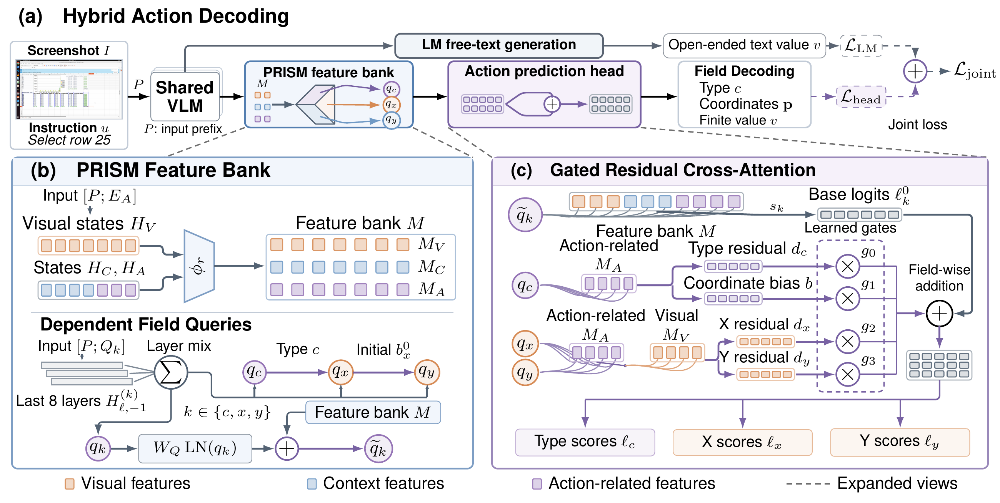

# GUI-PRISM: Efficient Action Decoding for GUI Agents



GUI-PRISM predicts structured action fields with dependent queries and gated residual cross-attention, while generating open-ended text values with the language model.

[Model weights](https://huggingface.co/L1007555652/GUI-PRISM)

## Setup

Use Python 3.10 or newer and a CUDA-compatible PyTorch installation.

```bash
pip install -r requirements.txt
python download_weights.py
```

The private weights repository requires Hugging Face authentication. The checkpoint contains the PRISM head, LoRA adapters and implicit embeddings; the base model is `Qwen/Qwen3-VL-8B-Instruct`. Set `training.model` in `configs/prism.json` to its Hub ID or local directory.

## Evaluation

```bash
python evaluate.py --config configs/prism.json --checkpoint weights/GUI-PRISM.pt \
  --benchmark screenspot --data data/screenspot.jsonl --output outputs/screenspot.jsonl
python evaluate.py --config configs/prism.json --checkpoint weights/GUI-PRISM.pt \
  --benchmark osworldg --data data/osworldg.jsonl --output outputs/osworldg.jsonl
```

Use `--benchmark action` to generate complete actions. Each output includes the action, generated text-token count and inference latency. For AC-v2 and MM-Mind2Web-v2, apply the benchmark's official complete-action scorer to these predictions.

For parallel evaluation, run one process per GPU with distinct `CUDA_VISIBLE_DEVICES`, `--shard`, `--num-shards` and output paths. Existing output files are never overwritten. This is the portable reference decoder; its latency should not be substituted for the paper's optimized deployment timings.

## Training

```bash
torchrun --standalone --nproc_per_node=8 train.py --config configs/prism.json \
  --stage warmup --data data/native.jsonl --batch-size 32 --output outputs/warmup

torchrun --standalone --nproc_per_node=8 train.py --config configs/prism.json \
  --stage joint --init outputs/warmup/checkpoint-002545.pt \
  --data data/joint.jsonl --batch-size 32 --epochs 2 --output outputs/joint
```

Warm-up freezes the backbone and trains the head. Joint training updates the head, LoRA adapters and inherited embeddings. Supply the corresponding initialization checkpoint with `--init` when reproducing an initialized stage. This option loads model parameters, not optimizer state. The checkpoint number depends on dataset size and batch size.

Use the same joint entry point with the continuation data and its parent checkpoint for grounding continuation. Mark supplemental grounding records with `coordinate_only: true` and a normalized `point_2d`; they supervise coordinate losses with Click-conditioned queries. Native records retain applicable action and language losses. Training writes intermediate checkpoints every 500 updates by default.

## Data

Inputs are JSONL records with `id`, `image` and `instruction` (or `user`). Image paths are local paths. Keep interaction history in the instruction text.

- Grounding evaluation additionally requires `image_size: [width, height]`. ScreenSpot uses `bbox_xyxy_original: [left, top, right, bottom]` in original pixels. OSWorld-G uses `box_type` (`bbox`, `polygon` or `refusal`) and original `box_coordinates`; bbox entries are `[left, top, width, height]`.
- Native training requires `action: {"action_type": "Click", "value": "None", "point_2d": [420, 360]}`. Coordinates use `[0,1000]`; missing coordinates use the string `"None"`. `mode` defaults to `trajectory`; grounding prompts use `screenspot` or `osworldg`.
- Supplemental records require `coordinate_only: true`, `point_2d: [x,y]` and a grounding `mode`. Repeat records in the input JSONL to express the desired sampling schedule.

The original datasets are not bundled. Keep their train/test splits separate. Configuration files expose image budgets and loss weights.
